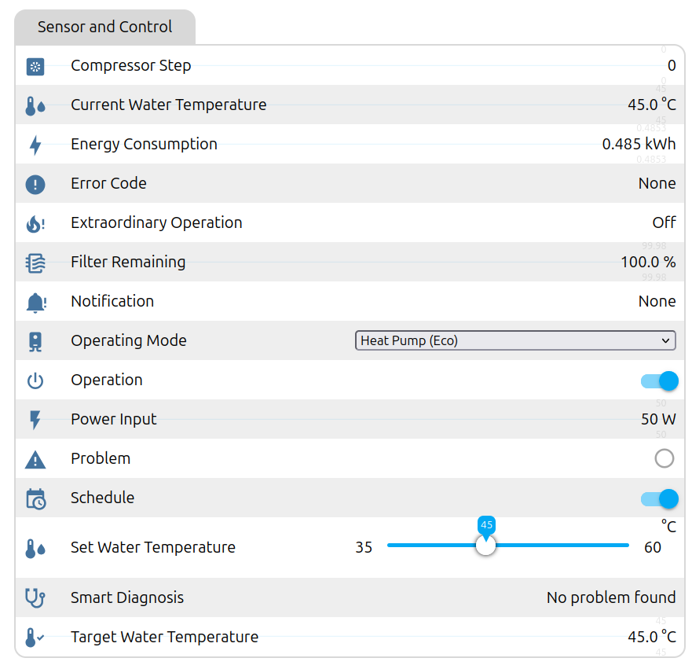
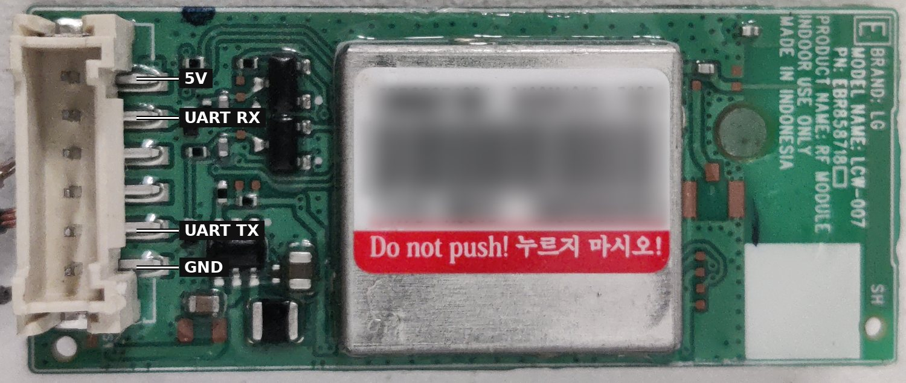

# LibreHeat

> Liberate your **LG WH27S** heat-pump water heater from the **LG ThinQ cloud** and get a **cloud free Home Assistant integration**.

This project replaces LG's Wi-Fi modem with an ESP32 running ESPHome, which
communicates directly with the heater over UART. It exposes status, operating
mode, temperature, on/off control, schedule status, energy consumption, error
codes, and Smart Diagnosis as native Home Assistant entities through the ESPHome API.

The UART protocol was documented through logic-analyzer captures between the
original modem and heater, with implemented commands verified on a WH27S.

## Features



## Hardware

- ESP32 board (tested: ESP32 DevKitC / `esp32dev`).
- Connect to the heater's modem connector: **5 V, TX, RX, GND**.

The heater's modem module is the LG LCW-007 (see the
[rethink wiki](https://github.com/anszom/rethink/wiki/LCW-007) for more pinouts). 


## Connecting the ESP32

```text
Heater modem connector          ESP32
   5V  Power             -----  5V
   TX (heater -> modem)  ---->  GPIO16 (UART RX)
   RX (modem -> heater)  <----  GPIO17 (UART TX)
   GND                   -----  GND
```



- **Signal level:** 3.3V TTL, non-inverted. 
- **5V:** power supply for the ESP
  never connect it to a GPIO pin.
- **UART:** 9600 baud, 8 data bits, no parity, 1 stop bit, no flow control.

Replace the LCW-007 modem with the ESP.

Kudos to [rethink LCW-007 reference](https://github.com/anszom/rethink/wiki/LCW-007).

## Software setup

Requires [ESPHome](https://esphome.io) 2026.10 or newer. Install it once with
[uv](https://docs.astral.sh/uv/getting-started/installation/):

```sh
uv tool install esphome
```

Alternatively, use `pipx install esphome` if you have pipx installed.

1. **Configure**

   ```sh
    cp secrets.example.yaml secrets.yaml
   ```

    Fill in your Wi-Fi, OTA, and web credentials in `secrets.yaml`.
   Edit `static_ip` and `gateway` at the top of [lg-wh27s.yaml](lg-wh27s.yaml), or
   remove the `manual_ip` block to use DHCP.

2. **First flash over USB**

   ```sh
    esphome run lg-wh27s.yaml
   ```

    Use the same command for subsequent updates over Wi-Fi (OTA).

3. **Wire it up.** With the heater powered off, disconnect the LG modem, connect the
   ESP as shown above and power up.

The ESP's web UI should fire up, and you can also update the firmware from there.

## Home Assistant

Home Assistant discovers the device automatically.

## Entities

### Controls

| Control | Options |
|---|---|
| Operation | On / standby |
| Schedule | Panel indicator / remote-off permission |
| Operating Mode | Heat Pump (Eco), Auto, Turbo, Vacation |
| Set Water Temperature | 35–60 °C |


### Main sensors

| Sensor | Value |
|---|---|
| Current / Target Water Temperature | °C |
| Power Input | W |
| Energy Consumption | kWh persistent total |
| Compressor Step | Compressor stage, 0 = off |
| Filter Remaining | % reset via panel SET long-press |
| Error Code / Problem | Fault code, description, fault indicator |
| Notification | Heater alerts |
| Smart Diagnosis | Local fault analysis |
| Extraordinary Operation | Emergency heating flag |

**Diagnostics:** firmware identifiers, capabilities, raw heater values, and command
status are available in Home Assistant. UART byte/frame counters and transport
error counters stay internal to ESPHome to avoid activity log noise. Firmware
logging defaults to warnings and errors.

## How the controls work

These behaviours come from the heater's firmware. They were captured from the
original LG modem and app, not designed by this project.

- **Operation off:** enables **Schedule** if needed, then puts the heater in
  standby and stops the compressor.
- **Operation on:** turns the heater on with the current mode and target temperature.
- **Turning Schedule off while the heater is off switches the heater back on.** The
  heater does this itself.
- **Operating Mode** and **Set Water Temperature** are sent together with the
  current value of the other setting, exactly as the LG modem does.
- Writes are never retried automatically. If one shows *Not confirmed*, check the
  panel and try again.

See [docs/schedule.md](docs/schedule.md) for the captured LG schedule sequence.

## Automations

The heater has no schedule store of its own; LG's app schedules are carried out by
the cloud. With this firmware, Home Assistant plays that role. A night-time
standby window, for example:

```yaml
automation:
  - alias: Water heater off at night
    trigger: { platform: time, at: "23:00:00" }
    action: { service: switch.turn_off, target: { entity_id: switch.lg_wh27s_water_heater_operation } }
  - alias: Water heater on in the morning
    trigger: { platform: time, at: "05:30:00" }
    action: { service: switch.turn_on, target: { entity_id: switch.lg_wh27s_water_heater_operation } }
```

**Manual high-temperature cycle with PV surplus:** target **60 °C**, one-hour hold
after the measured tank temperature reaches 60 °C, then restore the previous target.
Not a verified replacement for the built-in anti-Legionella cycle; scalding risk.

## Limitations

- **Legionella/disinfection** isn't reported or settable over the UART. Toggling it
  on the panel changes nothing on the bus, so it can only be changed on the panel.
- **Energy history** (daily/monthly) was computed by LG's cloud. The ESP
  accumulates its own total instead. Use Home Assistant statistics for history.
- **Compressor Step, Current/Voltage Raw** have no verified physical scaling.
- The **API and the UART bridge are unauthenticated**. Keep the ESP on a trusted
  LAN, or add `api: encryption:` to the configuration.

## Troubleshooting

| Symptom | Check |
|---|---|
| `UART Read Session: No response` | TX/RX swapped, missing GND, or the LG modem is still connected |
| `UART CRC Errors` rising | Bad wiring, wrong signal level, or interference |
| A control shows *Rejected: no fresh status* | No status received in the last 60 s; press `UART Start Read Session` |
| Operation off shows *Not confirmed* | Check the panel; the heater must accept Schedule = on first |
| Device shows an old name in HA | Rename it as described in [Home Assistant](#home-assistant) |

## Development and tests

[Development guide](docs/development.md): project layout, tests, and UART debug bridge.

## License

This project is licensed under the [MIT License](LICENSE), which permits use,
modification, and redistribution, including commercial use, provided the copyright
and license notice are retained. The software is provided without warranty.

Third-party trademarks, firmware, and software remain subject to their respective
owners' rights and licenses.


## Disclaimer.

This is an independent, unofficial project and is not affiliated
with, endorsed by, or sponsored by LG Electronics. LG, LG ThinQ, and other LG
names and trademarks are used solely to identify the products this project works with and remain the property of their respective owners.

You're opening an appliance that's connected to mains power and water. Work only on a powered-off unit, and only if you're competent to do so. You use
this at your own risk, and it may void your warranty.