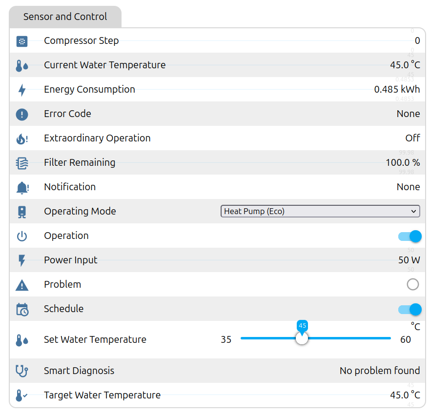

# Schedule mode and on/off

This explains how the WH27S's "Schedule" mode works and how this firmware uses it
to switch the heater on and off. The command sequence below was captured with a
logic analyzer while the ThinQ app ran a schedule, then reproduced and confirmed
with this firmware.

## What the LG app offers

In the ThinQ app a schedule is just a **time window**. There are no per-step
temperatures or modes. The heater runs inside the window and is in standby outside
it. While a schedule exists, the panel shows **"Schedule"**.

## What the heater does by itself

The heater has **no clock and no schedule memory**. Its capability report says so:
field 723 = `0x20000` is LG's "not used" for schedules. All it has is one flag:

| Field | Name | Effect |
|---|---|---|
| **649** | `MT_PREHEAT_SCHEDULE_STATUS` | 1 = schedule active: the panel shows "Schedule" **and** remote standby (`503 = 0`) is allowed |

With 649 = 0 the heater acknowledges `503 = 0` but ignores it. That's why a plain
"off" command never worked before the stock capture.

## What the LG modem and cloud send

Captured with the app; modem → heater frames, route 65, service 02, opcode 01:

| Moment | Frame payload | Heater reaction |
|---|---|---|
| Schedule created / enabled | `649 = 1` (`a241`) | 649 = 1, "Schedule" appears |
| Window **start** | `503 = 1, 505 = mode, 510 = target × 2` (`7dc1 7e50 19 7f90 6c`) | stays/turns on |
| Window **end** | `503 = 0` (`7dc0`) | **503 = 0**, compressor stops (standby) |
| Schedule disabled / deleted | `649 = 0` (`a240`) | 649 = 0, "Schedule" disappears, **heater switches itself back on** (503 = 1) |

The captured modem traffic contains on/off writes at the scheduled boundaries,
not a schedule uploaded to the heater. Home Assistant automations provide this
timing in the local setup.

## How this firmware maps it



| Entity | You do | ESP sends | Done when |
|---|---|---|---|
| **Schedule** on | switch on | `649 = 1` | heater reports 649 = 1 |
| **Schedule** off | switch off | `649 = 0` | heater reports 649 = 0 (and switches on if it was off) |
| **Operation** off | switch off | `649 = 1` if needed, then `503 = 0` | heater reports 503 = 0 |
| **Operation** on | switch on | `503 = 1, 505 = current mode, 510 = current target` | heater reports 503 = 1 |

`Operation Command` and `Schedule Command` show *Pending*, *Confirmed* or *Not
confirmed* for each request. Commands are sent once and never retried
automatically.

### Things to know

- After switching **Operation off** and back **on**, **Schedule stays on**. That's
  harmless: it only means the panel keeps showing "Schedule". Turn it off if you
  don't want the indicator.
- **Turning Schedule off while Operation is off switches the heater back on.** That's
  the heater's own behaviour, identical to deleting a schedule in the LG app.
- The panel's own buttons still work and change the same fields. The ESP sees the
  change in the next report and updates the switches.

## Building schedules in Home Assistant

Because the heater has no schedule store of its own, Home Assistant replaces the LG
cloud. Switch **Operation** at the window edges:

```yaml
automation:
  - alias: Water heater window start
    trigger: { platform: time, at: "05:30:00" }
    action: { service: switch.turn_on, target: { entity_id: switch.lg_wh27s_water_heater_operation } }
  - alias: Water heater window end
    trigger: { platform: time, at: "22:00:00" }
    action: { service: switch.turn_off, target: { entity_id: switch.lg_wh27s_water_heater_operation } }
```

Optionally keep **Schedule** on all the time, so the panel shows that the heater is
under external schedule control. You can also combine the windows with mode or
temperature changes (e.g. Turbo during PV surplus). Those are separate commands.

## Evidence

- Stock capture: LG modem on analyser channel D4, heater on D6, 9600 8N1. App
  schedule window 20:56–20:58: `649 = 1` at creation, `503 = 1/505/510` at 20:56:10,
  `503 = 0` at 20:58:11 (heater 503 = 0, compressor 15 → 0), `649 = 0` at deletion
  (heater 503 = 1).
- Our earlier attempts with `503 = 0` while 649 = 0 (on its own, and combined with
  505/598) were ACKed and ignored.
- With this firmware: Operation off → `649 = 1`, `503 = 0` confirmed; Operation on →
  503 = 1 confirmed.
- Unit tests: `tests/test_wh27s_uart.cpp` checks the exact captured frames.
